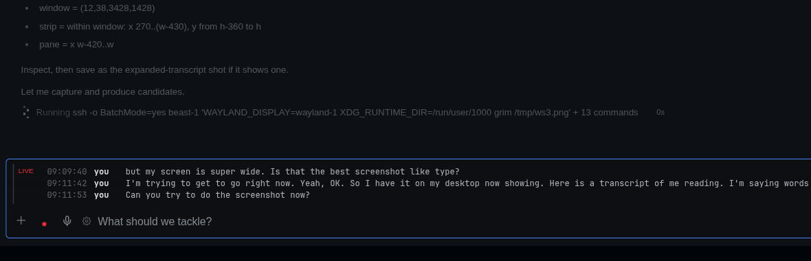

# hermes-call-recorder

Records both sides of a call as one two-track file and transcribes it locally with
speaker labels. **Linux (PipeWire)** and **Windows (WASAPI loopback)**; no virtual
cable, no driver, no admin rights.



## Install

```bash
hermes plugins install jacebenson/hermes-hackathon-call-recorder
hermes plugins enable call-recorder
```

## What it needs

Remote recording needs an `ssh` client on the Hermes host. On the machine being recorded:

| | |
| --- | --- |
| Linux | PipeWire with `pactl` and a `systemd --user` session, plus `ffmpeg` |
| Windows | Python 3, `python -m pip install pyaudiowpatch`, `ffmpeg` on PATH, and someone logged in |
| Transcription (optional) | `faster-whisper` on that same machine, otherwise recordings stay untranscribed |

Windows gives a background session no audio, so capture runs in the logged-in desktop:
the plugin launches it there itself and refuses when nobody is in. macOS capture is not
implemented.

```bash
# one-time Whisper runtime, Linux
uv venv ~/whisper/.venv && ~/whisper/.venv/bin/python -m pip install faster-whisper
```

Automatic Linux detection uses `tiny.en` with CPU int8 when no CUDA libraries are
found. GPU machines keep `small.en` or their detected local model with CUDA float16.
The pane's whisper line names the selected model and device. The first run downloads
the selected model if it is not cached. An explicit `whisper_model` override is preserved.

## Using it

Click `rec` by the composer. The chip shows a red dot and a timer, and turns **amber**
after thirty seconds of mic silence. Every stop path, including the pane and auto-stop,
saves usable live speech as the finished transcript when transcription is enabled.
If live speech is missing or cannot be saved, it queues a Whisper archive re-pass.
The toast names the pass that wrote the transcript, or reports when both failed.
Choose `Transcribe` in the pane to replace a transcript with a cleaner Whisper re-pass.

Auto-start is **off by default**. Turn it on and a call is detected as *a known call app
playing audio and capturing the mic at the same time*; playback alone is not a call. With
auto-stop on, the recording ends three minutes after the call disappears, so a screen
share or a dropped window does not truncate it.

Files stay on the machine that recorded them: `call-YYYYMMDD-HHMMSS.mkv` with a `system`
and a `mic` track, plus `call-YYYYMMDD-HHMMSS.transcript.md`. Live transcription writes
`call-YYYYMMDD-HHMMSS.live.txt` beside the recording. Its timestamps mark chunk completion,
not precise word timing. Two tracks, not a mix, make speaker labels possible without
diarisation. The pane lists recordings by title or date, opens a transcript, puts one in
the composer, or deletes the recording and both transcript files. Expand a recording and choose
`Rename`. Enter saves, Escape cancels, and an empty title restores the date. Titles are
trimmed, limited to 120 characters, and cannot contain control characters. They stay in
`.titles.json` beside the recordings, never in media filenames. Naming uses `python3`
on Linux or `python` on Windows, independent of Whisper. Click the live transcript
header to collapse or expand it. That choice lasts for the desktop session.

Four optional settings cover which machine, where to save, transcribe or not, and stop
when the call ends. Leave `host` empty to record on the machine Hermes runs on.
The pane identifies it as `local (hostname)` using the backend's hostname, not the
laptop displaying the desktop. `/config` also reports that backend's operating system.
If the desktop uses a remote gateway without audio devices, set `host` to the audio
machine's SSH host. A configured remote host keeps the name you entered.
To record somewhere else, name that machine and make sure Hermes can `ssh` to it
without a password. There is no host discovery.

For example, Hermes running on a server called `hermes-host`, with the microphone on a
laptop called `laptop`, means `host` is `laptop`, and `hermes-host` needs a working SSH
key to `laptop`. From a shell on the machine running Hermes, run:

```bash
ssh laptop true
```

It must return without asking for a password. In the pane, press `Test` next to
`Check again` for the in-app check. It checks the connection, OS, audio sources,
ffmpeg and where Whisper lives. Each step reports ok or failed. Failures appear
first. A missing Whisper runtime means recording only, not a broken connection.

## What it touches

* Shell commands run locally or over SSH: `pactl`, `ffmpeg`, `systemctl --user`
  on Linux; `powershell`, `ffprobe` and scheduled tasks on Windows. The pane reads
  live transcripts through the plugin API over SSH for remote hosts. The recording
  machine opens no HTTP viewer or listening port. The plugin does not read SSH
  configuration or keys. `ssh` itself uses your existing key.
* Helper scripts are written to `~/.local/share/call-recorder/` on Linux or
  `%USERPROFILE%\.call-recorder\` on Windows. Windows rewrites capture helpers on
  every start. Linux re-checks transcription helpers on detection, cached for five
  minutes. The Windows Test action writes a temporary audio probe, runs it as an
  interactive scheduled task, then removes the task and temporary files.
* Background capture uses a `systemd --user` unit on Linux or a scheduled task and
  Python process on Windows. Capture stops with the recording. A watcher thread
  polls for calls when auto-start or auto-stop is enabled.
* Transcription runs on the capture machine before upload, or on the backend for
  stored recordings, with no cloud transcription, telemetry or stored credentials.
  Whisper fetches a model if none is present.
  Files created include the `.mkv`, `.transcript.md`, `.live.txt`, `.titles.json`
  and small state files. After stop and transcript finalization, remote recordings
  and their sidecars are copied over SSH to the Hermes backend at
  `$HERMES_HOME/plugin-data/call-recorder/<machine>/`, defaulting to
  `~/.hermes/plugin-data/call-recorder/<machine>/`. Sources stay on the capture
  machine. Local capture is indexed without copying its files.
* The Recordings list combines backend history with files only on the selected
  capture machine, newest first. Each row names the capture machine and says
  `stored` or `remote-only`. Failed copies show their error and retry on list
  refresh. Per-file receipts prevent successful copies from repeating, including
  after a backend restart. Stored actions use the backend copy, so a new Whisper
  pass on a stored recording requires Whisper on the backend. Deleting a stored
  recording also removes its original capture file and sidecars. If that machine
  cannot be reached, deletion reports the failure and keeps the stored copy.

## Limits

- macOS capture is not implemented.
- English transcription by default; one recording at a time.
- A live-voice session in the same browser holds the mic and plays audio, so it looks
  like a call. Leave auto-start off if that matters.

## Development

```bash
python3 -m unittest discover -s tests
node --experimental-vm-modules --no-warnings tests/desktop.test.mjs
node --check desktop/plugin.js
hermes plugins validate .
```

## License

MIT, see [LICENSE](LICENSE).
