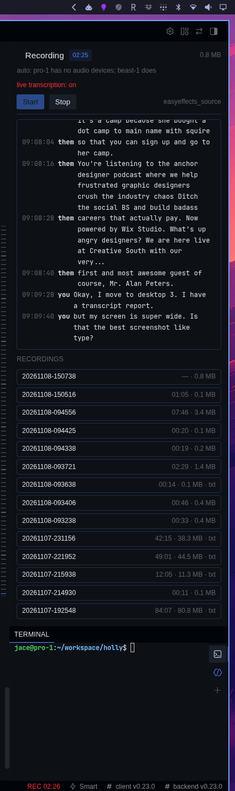
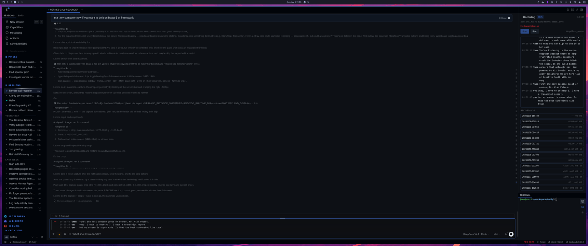

# hermes-call-recorder

A Hermes plugin that records both sides of a call — the audio you hear *and* your
mic — then transcribes it live while you talk and properly afterwards.

Built because "record the call so I can review it later" should not mean opening
OBS, hunting for the right PulseAudio source, and losing the half of the
conversation that came out of your headphones.

## What it looks like


While a call is recording, the last few transcribed lines sit above the composer,
labelled `LIVE` and split by speaker. The `rec` control is the dot in the composer;
the elapsed time lives in the status bar.



The pane carries the state (`Recording`, or the reason it cannot record), the
live transcript, the recordings with their durations and sizes, and a transcript
per recording.



## What you get

- **A `rec` button in the composer.** Click to start, click to stop. It counts up
  while it records.
- **A status chip** — dim `rec` when idle, red `REC 12:34` while rolling.
- **A pane** with the live transcript, the finished recordings, and their
  transcripts readable in place.
- **Automation.** A call is detected as *a known call app that is both playing
  audio and capturing the mic*. When one appears, recording starts by itself.
  When it disappears, the recorder waits `auto_stop_seconds` (default 3 minutes)
  before stopping — long enough that a dropped window, a screen share or a muted
  minute never truncates anything. Press **Keep recording** to cancel the countdown.

Playing audio alone is deliberately *not* a call: that is a YouTube tab, and this
check exists because a YouTube tab is exactly what got recorded by accident the
first time this was built.

## Requirements

On the machine whose audio you want to record (the *target host*):

- Linux with PipeWire (`pactl`, `systemd --user`)
- `ffmpeg`
- Optional, for transcription: `faster-whisper`, plus `live.py` and `archive.py`
  from the companion scripts. Without them the plugin still records; it just
  cannot transcribe.

The machine running the Hermes gateway needs `ssh` access to the target host when
they are not the same box.

## Install

```bash
hermes plugins install jacebenson/hermes-hackathon-call-recorder
```

Then add `call-recorder` to `plugins.enabled` in `~/.hermes/config.yaml` and
restart the gateway so the dashboard routes and the desktop half load.

## Configure

Four questions, in the order they matter. This is the whole settings page.

**1. Machine that records.** The computer with the microphone and the headset. Leave
it empty and it is chosen for you: the machine where a call is in progress, else the
first machine in your SSH config that has audio devices. Fill it in only to pin one.

**2. Save recordings to.** A folder on that machine. Recording happens where the
audio is, so the mkv and its transcript stay there — the file is already on disk and
survives the connection dropping mid-call.

**3. Transcribe recordings.** On by default. It needs a Python on the recording
machine that can import `faster-whisper`; the recorder looks for one, copies its own
`live.py` and `archive.py` there (into `~/.local/share/call-recorder`), and says so
in the pane when it cannot find a runtime. Off means record-only.

**4. Stop when the call ends.** Three minutes of grace after the call disappears,
then it stops and transcribes. Off means record until you press stop.

Nothing here has to be filled in for a working install: an untouched settings page
records on the right machine, transcribes, and stops on its own. Every field exists
only to pin something specific.

Advanced keys (`python`, `live_script`, `auto_start`, `auto_stop_seconds`,
`watch_seconds`, `whisper_model`) are still honoured through `CALLREC_*` environment
variables or a `settings.json` beside `plugin.yaml`, but they are deliberately not on
the page.

## While recording

The composer button is the whole interface:

- idle shows `rec`;
- recording shows a red dot and a timer that ticks every second;
- if the microphone has been at digital silence for thirty seconds the dot turns
  **amber** and the tooltip says the mic is silent — a muted call and a working one
  look identical otherwise;
- stopping shows `transcribing…` and then `transcript ready`, with the recording
  waiting in the pane.

Live transcription runs during the call when the recording machine has a Whisper
runtime; the pane says `live transcription: on` while it does. Without a runtime
there is no live view — the upload route Hermes exposes is one-shot, not streaming.

## Transcription

One path, two engines, no configuration. The recording is cut into two-minute
slices and each slice is transcribed by whichever engine this machine can use:

* **GPU** — faster-whisper on the recording machine. Fastest, keeps the audio
  local, and gives per-line timing.
* **Hermes** — the speech-to-text Hermes already has configured (the same one
  push-to-talk uses). No install, no GPU, coarser timing: one stamp per slice,
  because the upload route returns text without segments.

The GPU is tried first because it is roughly ten times faster; if the recording
machine has no Whisper runtime — Windows, a fresh Linux box — Hermes's own
transcription takes over. If a GPU pass fails part-way it falls through to Hermes
rather than losing the recording.

Live transcription still needs a runtime on the recording machine: the upload
route is one-shot, not streaming.

## Platform support

| | today |
| --- | --- |
| Machine being recorded | **Linux with PipeWire.** It needs `pactl`, `ffmpeg` and a `systemd --user` session. |
| Machine running Hermes | Linux. Remote targets are reached over SSH; local execution assumes a POSIX shell. |
| Windows as the recorded machine | Partly. Capture works: two DirectShow devices into a two-track mkv over SSH, with ffmpeg, PID-based stop and a remux to finish. It needs a loopback driver (VB-CABLE) to hear the call itself, and without one the plugin reports blocked and names the driver to install. The plugin's Windows runner has not been exercised end to end yet. |
| macOS as the recorded machine | Not supported yet. Needs BlackHole and an avfoundation capture path that has not been tested on real hardware. |
| Transport | SSH only. No HTTP agent, so nothing new listens on the recorded machine and the SSH key is the credential. |

## Windows: install the loopback driver first

Windows has no monitor source the way PipeWire does, so the machine cannot hear the
call until a virtual cable exists. One install, done once per machine:

```powershell
# administrator PowerShell
choco install vb-cable -y
```

No Chocolatey? The same driver comes from [vb-audio.com](https://vb-audio.com/Cable/)
as a zipped installer, and needs a reboot before the device appears.

Then two settings, both required:

1. **Point the call at it.** In the meeting app, set the speaker to `CABLE Input
   (VB-Audio Virtual Cable)`. The call's audio now flows into the cable.
2. **Listen to the cable.** Windows sound settings → Recording → `CABLE Output` →
   Properties → Listen → tick *Listen to this device* → pick your headphones.

Step two is the one people skip: without it the room goes silent, because the call's
audio is being captured by us instead of played to you. Volume still works normally.

A note from doing this over SSH: the driver files land, but the device only appears
after a real restart, and the installer's own dialog needs a desktop session. Plan for
one restart, at the machine, not from a remote shell.

**Use Restart, not Shut down.** Windows ships with fast startup on, which hibernates
the kernel: shutting down and powering back on restores the old session instead of
reloading drivers, so the cable stays missing and the uptime counter never moves.
That looks exactly like "the install did nothing".

Now `Readiness` turns `ready`, and recordings are named `call-YYYYMMDD-HHMMSS.mkv`
with a `system` track and a `mic` track. Delete the cable later and the plugin goes
back to reporting `blocked` with the fix — it does not record half a call silently.

SSH is the *client* side on the Hermes host, which Windows 10+ ships as `ssh.exe`,
so driving a Linux desktop from a Windows gateway is mostly a matter of replacing
the `bash -lc` local runner. An HTTP agent would work too but it means opening a
port and inventing an auth story — the reason it is not the default.

## How it works

```
composer button / pane / chip        (desktop/plugin.js)
            |
            v
  /api/plugins/call-recorder/*       (dashboard/plugin_api.py)
            |
            v
       recorder.py  --- ssh --->  target host
                                    pactl          detect call + pick sources
                                    systemd-run    ffmpeg -> call-<ts>.mkv
                                    faster-whisper live.txt + transcript.md
```

One ffmpeg process captures two streams into one matroska file: the monitor of
the sink the call app plays into (track `system`) and the default source
(track `mic`). Two tracks, not a mix — that is what makes speaker labelling
possible later without diarisation.

Recording runs as a transient `systemd --user` unit, so it survives the dashboard
restarting, the SSH connection dropping, and the browser tab closing.

## API

| route | purpose |
| --- | --- |
| `GET /config` | settings actually in effect, and whether the target answers |
| `GET /status` | `{recording, live, elapsed, bytes, monitor, mic, pending_stop}` |
| `POST /start` | `{"live": true}` — begin recording |
| `POST /stop` | stop and report the file + duration |
| `POST /keep` | cancel a pending auto-stop |
| `GET /call` | who is playing and who has the mic right now |
| `GET /transcript?lines=60` | tail of the live transcript |
| `GET /recordings` | recent recordings, sizes, durations, transcript presence |
| `GET /transcript/read?path=…` | markdown of a finished transcript |
| `POST /transcribe` | `{"file": "…"}` — run the archive pass |

## Tests

```bash
python3 -m unittest discover -s tests -v
```

The tests cover the parts that actually break: picking the right monitor, telling
a call apart from a browser tab, and the start/delay/stop decisions.

## Limits

- Linux + PipeWire only. No macOS or Windows capture path.
- English transcription (change `language` in the scripts for anything else).
- One recording at a time.
- Voice sessions in the same browser (e.g. a live-voice plugin) also hold the mic
  and play audio, so they look like a call. Set `auto_start: false` if that
  matters more than the convenience.

## License

MIT — see `LICENSE`.
