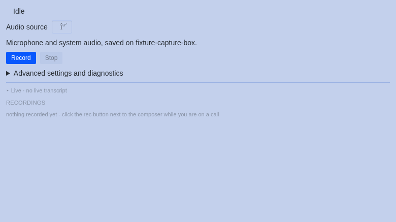
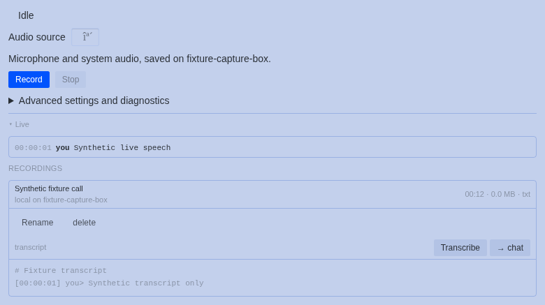

# Native restoration checks

Baseline: `00ce57a6cd411fcdda2249d9b273bcbb19852981`, the latest native-capable release including PR5. Base: `e46c5ad`, including merged PR7/8 and PR6. Version: 2.1.0, above current 2.0.0.

The primary `desktop/plugin.js` is byte-identical to the pinned native baseline. Manifest settings and Python entrypoint are restored. Dashboard import remains inert, unlike the baseline's import-time watcher. A user start arms the native auto-stop watcher. No installer writes to a real Hermes home were performed.

## Security carried forward

- PR5 `Recorder._mine`, transcript basename/directory confinement and pre-work `/transcribe` validation remain unchanged from main. Valid native/library/browser-stored records still work.
- Profile-aware config fallback and settings precedence remain. The dashboard host supplies a router, not a PluginContext config accessor.
- PR6 structured `CaptureUnavailable` handling remains, including actionable no-audio errors and stopping the watcher rather than retry flooding.
- Windows/Linux capture helpers, native library and transcription modules are unchanged from main.
- Watcher recovery now clears its start latch on exit and startup failure, with serialized start ownership. The next explicit start can re-arm it after missing audio.

## Executed checks

```sh
python -m unittest discover -s tests
node --experimental-vm-modules --no-warnings tests/desktop.test.mjs
node tests/browser-capture.test.mjs
node tests/local/core.test.mjs
node tests/local/library.test.mjs
node --check desktop/plugin.js
python -m compileall -q .
git diff --check
HERMES_HOME="$(mktemp -d "$TMPDIR/native-validate-XXXXXX")" hermes plugins validate . --json
```

Python: 151 passed. Dormant v2 core/library: 18 and 12 passed. The full Python suite includes both review attack routes with a command recorder and zero caller-path command execution before refusal, legitimate transcripts/archive, library copies and browser-stored access. Tests use synthetic paths/files, not credentials. The disposable installation test imports only copied package runtime files, fences helper/process/thread startup, and confirms no settings/recordings are created.

The real installed Python `PluginManager` also scanned and loaded a copied unified package in a fresh disposable HERMES_HOME, reporting enabled version 2.1.0, no errors and no tools/hooks/middleware. The host's own version lookup and bounded loader thread were permitted; plugin subprocesses and its watcher were fenced.

`test_native_synthetic.py` exercises production native start/status/stop, real FFmpeg two-track lavfi media, ffprobe, live-sidecar finalization, transcript reads and library indexing in a disposable home. Service launch is translated to synthetic tones; physical audio and live Whisper are not used. It proves route/lifecycle wiring, not hardware or speech recognition.

## Failing before, passing after

`tests/test_native_restoration.py` initially failed twice on unchanged main dashboard code: new installs selected browser, and `_WATCHER_STARTED` remained true after a no-audio failure. Both pass after the change. Its recovery test exercises the real watcher exit and a subsequent start request.

The restored desktop harness, with compatible React/window stubs, fails against main's desktop artifact at its explicit assertion that native record control, live strip, status chip and library pane must all register. The same command passes against this restoration. To reproduce without changing a checkout, copy the candidate tree to a disposable directory, replace only its `desktop/plugin.js` with `git show e46c5ad:desktop/plugin.js`, then run the desktop harness above.

## Isolated browser rendering

```sh
node tests/serve-sdk.mjs
# In a second shell, using a fresh headless Chromium profile:
PROOF_CHROME=/usr/sbin/chromium node tests/native.browser.mjs
CHROMIUM=/usr/sbin/chromium node tests/capture-target.browser.mjs
```

The native proof passed 7 checks using the real runtime loader, actual SDK components, React Query provider and production CSS. Only the desktop REST bridge/backend responses are fixtures. It rendered idle, recording, live transcript and expanded transcript/history, verified native `/start`, `/stop` and `/transcript/read`, and forbade physical microphone/screen access. Screenshots are fixtures, not evidence of actual capture. The source-selector proof also passed keyboard/recording guard and light/dark contrast checks.




## Not tested

No real Linux PipeWire/systemd or Windows WASAPI two-track call, physical microphone, live Whisper model, real SSH capture machine or live Electron window was exercised. Remaining hardware acceptance: on a consenting disposable capture machine, record both sides, observe live ASR, stop and read the finalized library transcript. No gateway restart, installed-plugin overwrite, capture-device attachment, catalog write, upstream reply or PR9 change was made. CI must be read on the published head separately.
